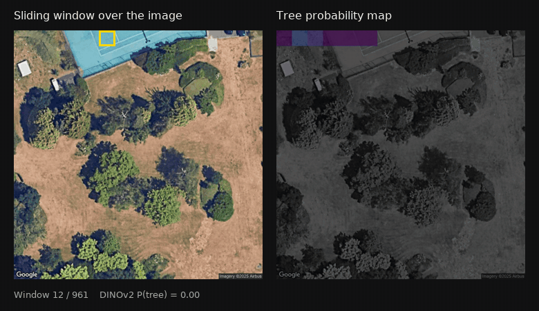
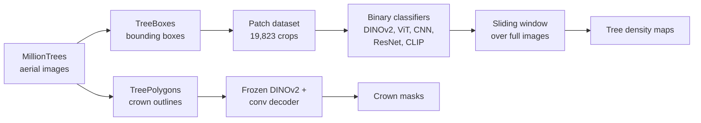
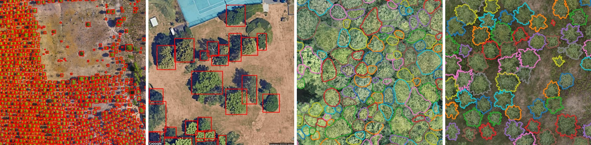
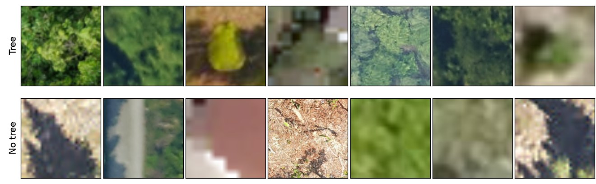
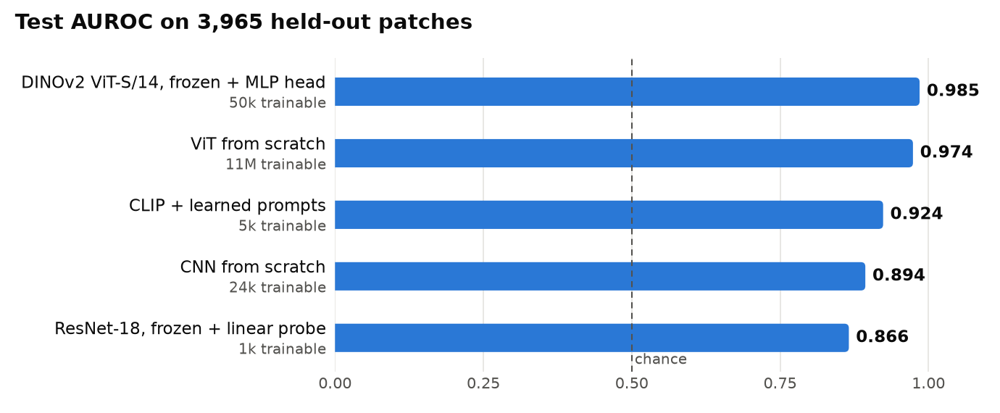
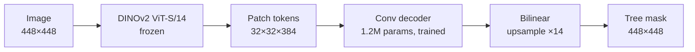
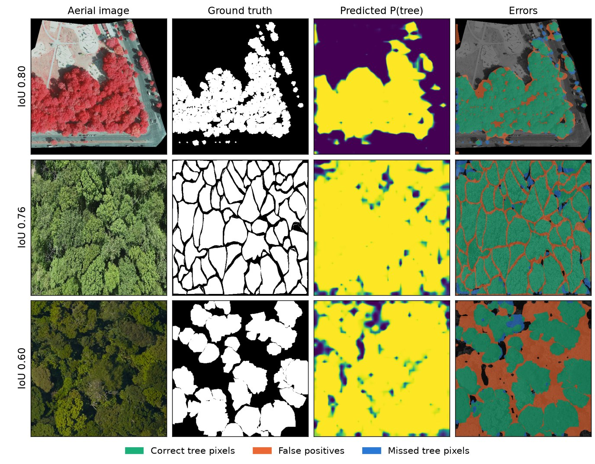
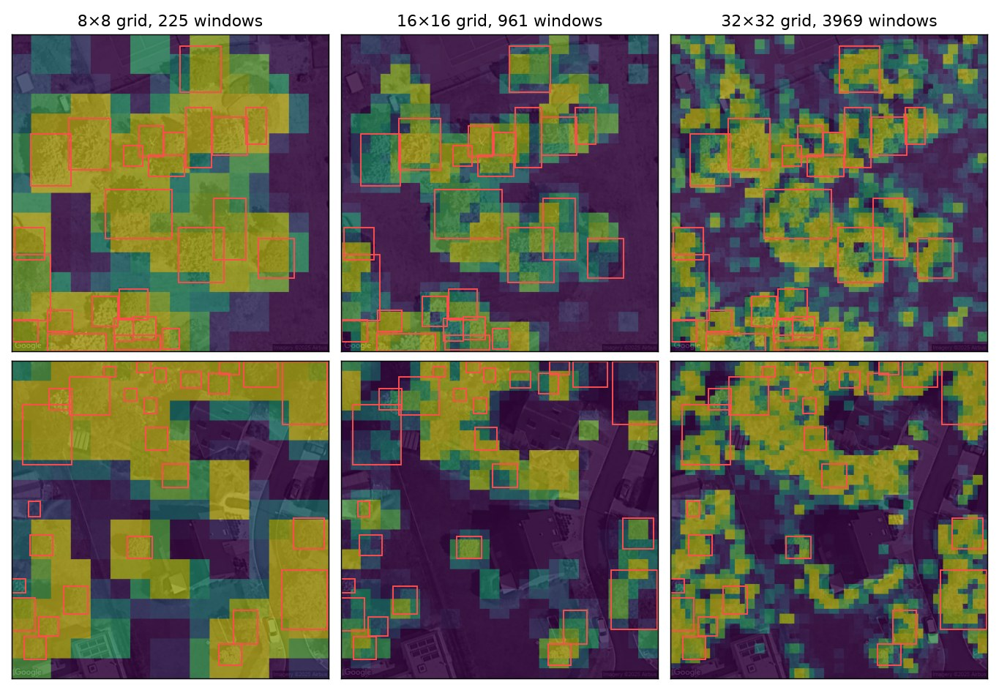
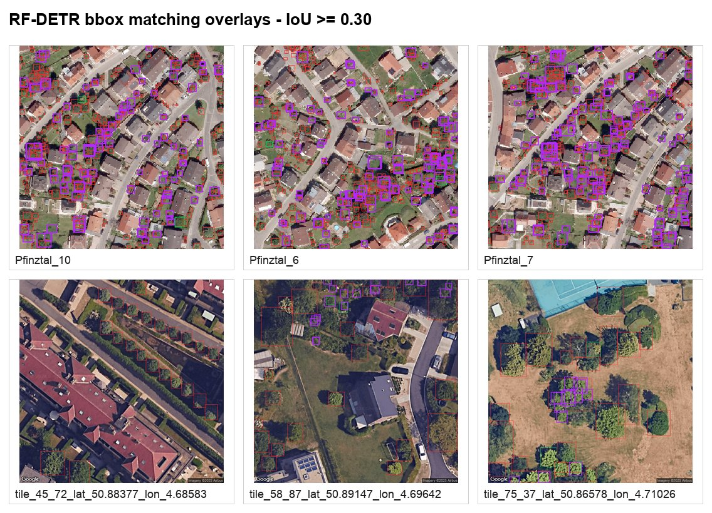

# Tree Classification and Segmentation from Aerial Imagery

Finding and delineating individual trees in drone and aerial images, using foundation models (DINOv2, CLIP), a Vision Transformer trained from scratch, and a sliding-window pipeline that turns a patch classifier into full-image tree density maps.

Built on the [MillionTrees](https://github.com/weecology/MillionTrees) benchmark as a Master's project at Sorbonne Université (M1 MIND, 2025–2026), in collaboration with Jacques Gignoux (IEES Paris).

<p align="center">
  
</p>
<p align="center"><em>A DINOv2 patch classifier, trained only on small crops, scans a full image. Real model output on one of the low-density scenes.</em></p>

## Highlights

| | Result |
|---|---|
| **Frozen foundation model wins** | DINOv2 with a 50k-parameter head reaches **0.985 AUROC**, ahead of every model trained from scratch |
| **Crown segmentation** | Frozen DINOv2 patch tokens plus a small conv decoder reach **0.95 recall, 0.71 IoU** |
| **From patches to full images** | The classifier produces tree density maps with no retraining (**0.81 recall** at the best grid size) |
| **Evaluation audit** | Replaying our own splits exposed a **93% test leak** in one dataset version, so those scores are excluded here |

**Stack:** PyTorch, DINOv2, CLIP, Vision Transformers, RF-DETR, Albumentations, scikit-learn, OpenCV

## Pipeline



## Data

MillionTrees gathers aerial imagery from many ecosystems and sensors, with three annotation types. We used the boxes for classification and the polygons for segmentation.

<p align="center">
  
</p>

**Patch dataset.** Each tree box is expanded 1.6× to keep some context, cropped, and resized to 224×224. Negatives are random windows whose IoU with every tree box is below 0.09. This gives **19,823 patches from 32 images** (13,577 tree, 6,246 no tree). Class-specific Albumentations pipelines then expand the training set.

<p align="center">
  
</p>

## Classification

Is there a tree in this patch? Models are compared on the same 3,965 held-out patches.

<p align="center">
  <picture>
    <source media="(prefers-color-scheme: dark)" srcset="docs/assets/results_auroc_dark.png">
    
  </picture>
</p>

| Model | Trainable params | V3 bal. acc. | V3 F1 | V3 AUROC | +aug bal. acc. | +aug F1 | +aug AUROC |
|---|--:|--:|--:|--:|--:|--:|--:|
| **DINOv2 ViT-S/14**, frozen + MLP head | 50k | **0.935** | **0.958** | **0.985** | **0.930** | **0.958** | **0.983** |
| ViT from scratch (6 layers, 6 heads) | 11M | 0.907 | 0.949 | 0.974 | 0.929 | 0.953 | 0.980 |
| CLIP + learned prompts | 5k | 0.828 | 0.907 | 0.924 | – | – | – |
| CNN from scratch (3 conv blocks) | 24k | 0.809 | 0.878 | 0.894 | 0.800 | 0.898 | 0.894 |
| ResNet-18, frozen + linear probe | 1k | 0.760 | 0.882 | 0.866 | 0.785 | 0.876 | 0.877 |
| CLIP zero-shot [^clip] | 0 | 0.500 | 0.811 | 0.33 | – | – | – |

- **V3:** 15,858 training patches. The test set also served as the validation set for early stopping.
- **+aug:** 25,372 training patches (originals plus augmented copies), a separate 6,344-patch validation set, and the same test set. This is the cleanest protocol.

**What we learned**

- **Pretrained features matter most.** With both backbones frozen, DINOv2 beats ImageNet ResNet-18 by about 0.12 AUROC. The ResNet probe used a much lower learning rate (2e-5 vs 1e-3), so part of that gap may be undertraining.
- **A from-scratch ViT gets surprisingly close**, probably helped by train and test patches coming from the same images (see the audit below).
- **Augmentation barely moves the strongest models.** The ViT gains 0.006 AUROC, and frozen DINOv2 stays flat.
- **Learned prompts are very cheap.** About 5k parameters on frozen CLIP image embeddings reach 0.92 AUROC. This is inspired by [CoOp](https://arxiv.org/abs/2109.01134), but the vectors act directly on the embeddings and skip the text encoder.

[^clip]: Scores were nearly constant across patches. The evaluation passes tensors already scaled to [0, 1] to `CLIPProcessor`, which rescales by default, so this number is likely a preprocessing artifact rather than a true measure of CLIP on aerial images. It was also measured on a 3,200-patch sample of the test set.

## Evaluation audit

Scores that look too good deserve a check, so we replayed every split with [`scripts/audit_splits.py`](scripts/audit_splits.py). It runs on a fresh clone in seconds.

| Check | Finding | Consequence |
|---|---|---|
| Test patches inside the **V4** training set | **93.2%** (79.7% verbatim, the rest as augmented copies) | V4 scores are invalid and are excluded above |
| Validation vs test split in **V3** | Identical (3,965 of 3,965) | Early stopping saw the test set, so V3 is slightly optimistic |
| Source images shared by train and test | **32 of 32** | All scores measure performance on seen scenes, not on new sites |

V4 was an enlarged augmented set whose training manifest also contained the test patches. The effect is clearest for the high-capacity models, which can memorize them:

| AUROC | +aug (clean) | V4 (leaked) |
|---|--:|--:|
| ViT from scratch | 0.980 | 0.995 |
| DINOv2 | 0.983 | 0.994 |
| CNN | 0.894 | 0.907 |
| ResNet-18 | 0.877 | 0.872 |

## Semantic segmentation

A patch label says *whether* there is a tree. Ecologists also need *where*, to measure crown area and growth. For this we swap DINOv2's `[CLS]` token for its spatial patch tokens and train a small decoder on top, with the backbone frozen.



The decoder is two 3×3 conv blocks (BatchNorm, ReLU, dropout) and a 1×1 classifier, trained with class-weighted cross-entropy plus Dice loss.

| Split | Images | Precision | Recall | IoU |
|---|--:|--:|--:|--:|
| **Test** | 5 | 0.74 | **0.95** | **0.71** |
| Validation | 6 | 0.62 | 0.80 | 0.53 |

<p align="center">
  
</p>
<p align="center"><em>Best, median and worst of the five test images. These are held-out images, not training examples.</em></p>

Scores are per-image means. `runs/dinov2_seg1/results.json` logs a test IoU of 0.74 because it averages over batches, which overweights the last image.

The model finds nearly every tree pixel but draws crowns too generously. Its 32×32 feature grid cannot recover fine boundaries, and in closed canopy it merges neighbouring crowns. With so few images, these scores are indicative only: the gap between test and validation shows how much they vary.

## Full-image localisation in sparse scenes

Ecologists often work with isolated trees, so we tested six low-density scenes. Each image is scanned with overlapping windows (50% stride), each window goes through the DINOv2 classifier, and every pixel keeps the highest probability of the windows covering it.

<p align="center">
  
</p>

Grid size trades spatial precision against visual context. Large windows blur neighbouring trees together, and very small ones no longer look like the crops the classifier was trained on.

| Grid | Windows per image | Precision | Recall | F1 | AUROC |
|---|--:|--:|--:|--:|--:|
| 8×8 | 225 | **0.738** | 0.597 | 0.660 | 0.746 |
| **16×16** | 961 | 0.632 | **0.805** | **0.708** | **0.896** |
| 32×32 | 3,969 | 0.301 | 0.587 | 0.398 | 0.814 |

These numbers come from the project report, and that run's outputs are not stored in this repository. A window counts as positive if it covers at least 60% of a tree box. The six scenes also contributed patches to the classifier's training data, so these are in-domain results.

<details>
<summary><strong>Preliminary detection experiment with RF-DETR</strong></summary>

<br>

To get individual boxes instead of a probability map, we fine-tuned RF-DETR Medium on the 26 other annotated images (17 train, 9 validation) and kept the six scenes for inference only. Results were poor: purple boxes are false positives, red are missed trees, and green are matches at IoU ≥ 0.3. So few distinct scenes are not enough to fine-tune a detector, which makes this a proof of concept. The training code is not part of this repository.



</details>

## Limitations and next steps

- **Split by site.** Group splits by source image, and use the MillionTrees zero-shot split to measure real generalisation.
- **Fix the known issues.** Rerun CLIP zero-shot with correct preprocessing, and align the sliding-window notebook with training (it adds ImageNet normalisation that training did not use).
- **More data.** Everything here uses the MillionTrees `mini` subset, so the next step is the full benchmark.
- **Sharper masks.** Try a multi-scale decoder and instance-level crown separation.
- **Better localisation.** Scan at several scales, and train a detector on far more scenes.

## Repository structure

```text
├── docs/
│   ├── assets/              README figures
│   └── project_brief.pdf    Original project description
├── notebooks/
│   ├── 01_data/             EDA, patch generation, augmentation
│   ├── 02_classification/   CNN, ViT, CLIP, ResNet, DINOv2, benchmarks
│   ├── 03_segmentation/     DINOv2 segmentation and visualisation
│   ├── 04_low_density/      Sliding-window density maps
│   └── archive/             Early experiments
├── runs/                    Metrics for every run (results.json)
├── scripts/
│   ├── audit_splits.py      Train/test leakage audit
│   ├── make_figures.py      Regenerates the README figures
│   └── train_dinov2_segmentation.py
├── splits/                  Exact patch manifests for each dataset version
├── src/                     Datasets, training loops, metrics
└── requirements.txt
```

Datasets (`data/`, `patches_dataset/`) and model weights are not tracked. Earlier versions are in the git history.

## Getting started

Use Python 3.10 to 3.12, because `milliontrees` does not support newer versions. A shallow clone is much faster since the history contains the old datasets:

```bash
git clone --depth 1 https://github.com/alan-man/trees_project_2026.git
```

```bash
cd trees_project_2026
```

```bash
python3.12 -m venv .venv && source .venv/bin/activate
```

```bash
pip install -r requirements.txt
```

**Check the audit** (needs no dataset):

```bash
python scripts/audit_splits.py
```

**Download the data** (the `mini` subsets, into `data/`):

```python
from milliontrees.datasets.TreeBoxes import TreeBoxesDataset
from milliontrees.datasets.TreePolygons import TreePolygonsDataset

TreeBoxesDataset(root_dir="data", download=True, mini=True)
TreePolygonsDataset(root_dir="data", download=True, mini=True)
```

**Reproduce the experiments.** Notebooks can be opened from anywhere, since their first cell moves to the repo root.

| Step | Run |
|---|---|
| Build the patch dataset | `notebooks/01_data/02_data_patches_generation.ipynb` |
| Augment it | `notebooks/01_data/03_augmentation.ipynb` |
| Train the classifiers | `notebooks/02_classification/` (`10_run_benchmarks_clf.ipynb` runs them all) |
| Train the segmentation model | `python scripts/train_dinov2_segmentation.py` |
| Build the density maps | `notebooks/04_low_density/13_low_density_corrected_pipeline.ipynb` |
| Regenerate the README figures | `python scripts/make_figures.py` (needs trained weights and ffmpeg) |

## Authors

**Alan Tambellini** ([@alan-man](https://github.com/alan-man)) and **Zahra Siddique** ([@ZahhS](https://github.com/ZahhS))

Supervised by Olivier Schwander (Sorbonne Université), in collaboration with Jacques Gignoux (IEES Paris).

## References

- Weinstein et al., *MillionTrees: A large-scale benchmark for individual tree detection from aerial imagery*, 2023. [GitHub](https://github.com/weecology/MillionTrees)
- Oquab et al., *DINOv2: Learning Robust Visual Features without Supervision*, 2023. [arXiv](https://arxiv.org/abs/2304.07193)
- Radford et al., *Learning Transferable Visual Models from Natural Language Supervision*, ICML 2021. [arXiv](https://arxiv.org/abs/2103.00020)
- Zhou et al., *Learning to Prompt for Vision-Language Models*, 2022. [arXiv](https://arxiv.org/abs/2109.01134)
- Carion et al., *End-to-End Object Detection with Transformers*, ECCV 2020. [arXiv](https://arxiv.org/abs/2005.12872)
